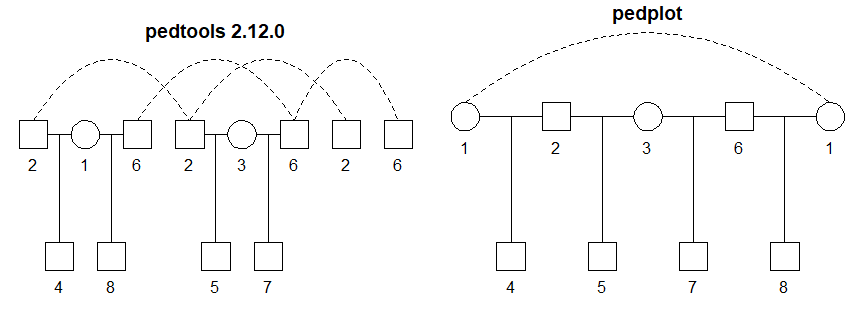
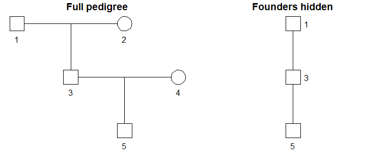
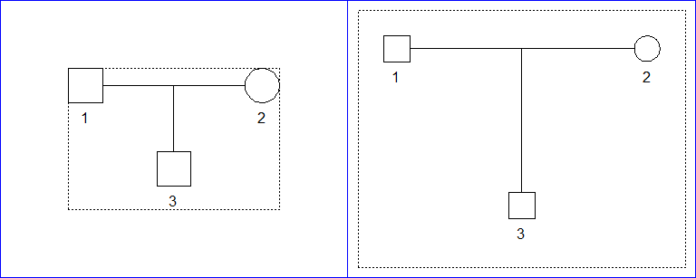
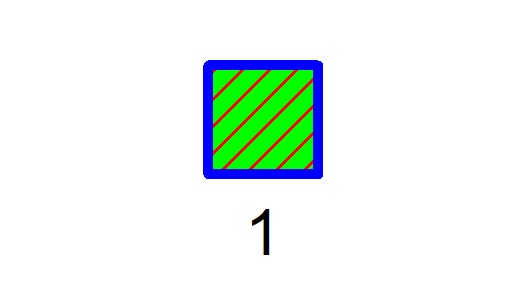
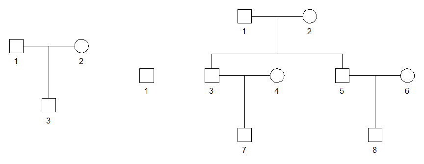

<!-- README.md is generated from README.Rmd. Please edit that file -->

# pedplot

**pedplot** offers a fresh take on pedigree plotting in R. It produces
plots similar to **kinship2** and early versions of **pedtools**, but
with better alignments in many complex pedigrees and several novel
features. In particular, **pedplot** is designed for use by other
packages, simplifying downstream manipulation of plot elements. It was
developed for the [pedsuite](https://pedsuite.org/), but also works with
ordinary data frame input.

## Installation

**pedplot** is not on CRAN yet, but can be installed from GitHub:

``` r
pak::pak("magnusdv/pedplot")
```

## Examples

The following examples illustrate some of the features of **pedplot**.
For convenience we use **pedtools** to create the pedigrees.

``` r
library(pedtools)
library(pedplot)
```

#### Fewer duplications

Complex pedigrees sometimes require duplicating individuals in the plot.
As such duplications tend to clutter the display, **pedplot** tries hard
to use as few as possible. The following example shows a half-sib mating
circle. Here **pedplot** needs only one repeated person, while
**pedtools** 2.12.0 uses four duplications.

``` r
x = halfSibPed() |> addSon(3) |> addSon(c(1, 6))
plot(x, title = "pedtools 2.12.0")
plotPed(x, title = "pedplot")
```



#### Hidden founders

A novel feature of **pedplot** is the ability to hide selected founders.
This often simplify the display of large pedigrees.

``` r
x = linearPed(2)
plotPed(x, title = "Full pedigree")
plotPed(x, hideFounders = c(2, 4), title = "Founders hidden")
```



#### Exact sizes

Symbol sizes, padding (inner margin) and outer margins can be specified
exactly, in mm, cm or inches. Padding can also be specified in “symbol
sizes” (the width of a person symbol). Here are two examples:

``` r
plotPed(nuclearPed(), 
        symbolsize = 1, symbolsizeUnit = "cm",
        margins = 2, marginsUnit = "cm")
box("plot", lty = 3); box("figure", col = "blue")

plotPed(nuclearPed(),  # auto symbol size
        padding = 1, paddingUnit = "sym",
        margins = 3, marginsUnit = "mm")
box("plot", lty = 3); box("figure", col = "blue")
```



#### Colours and annotations

Borders, fills and hatch lines can be controlled independently and
separately for each person.

``` r
plotPed(singleton(1), cex = 4, lwd = 10, 
        hatched = 1, hatchDensity = 5, hatchLwd = 3,
        col = "blue", fill = "green", hatchCol = "red")
```



#### Multiple pedigrees

A list of pedigrees can be plotted in one figure.

``` r
peds = list(nuclearPed(), singleton(), cousinPed())
plotPed(peds)
```



See `?plotPed` for more options. For finer control, `alignPed()`,
`scalePed()`, `partsPed()` and `drawPed()` give access to the individual
plotting steps.
